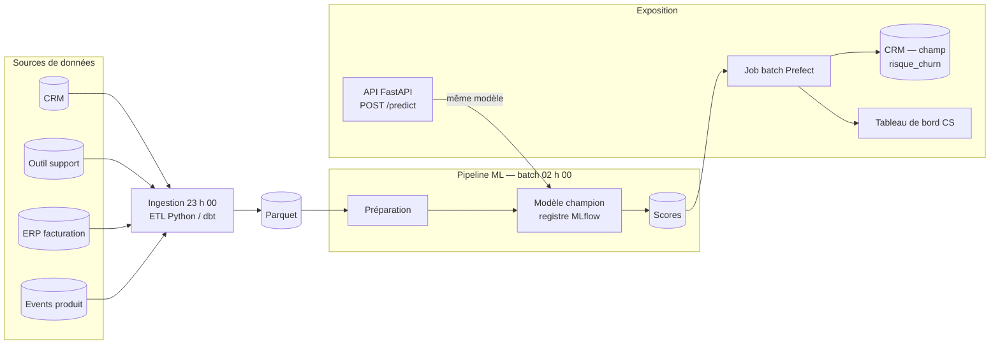
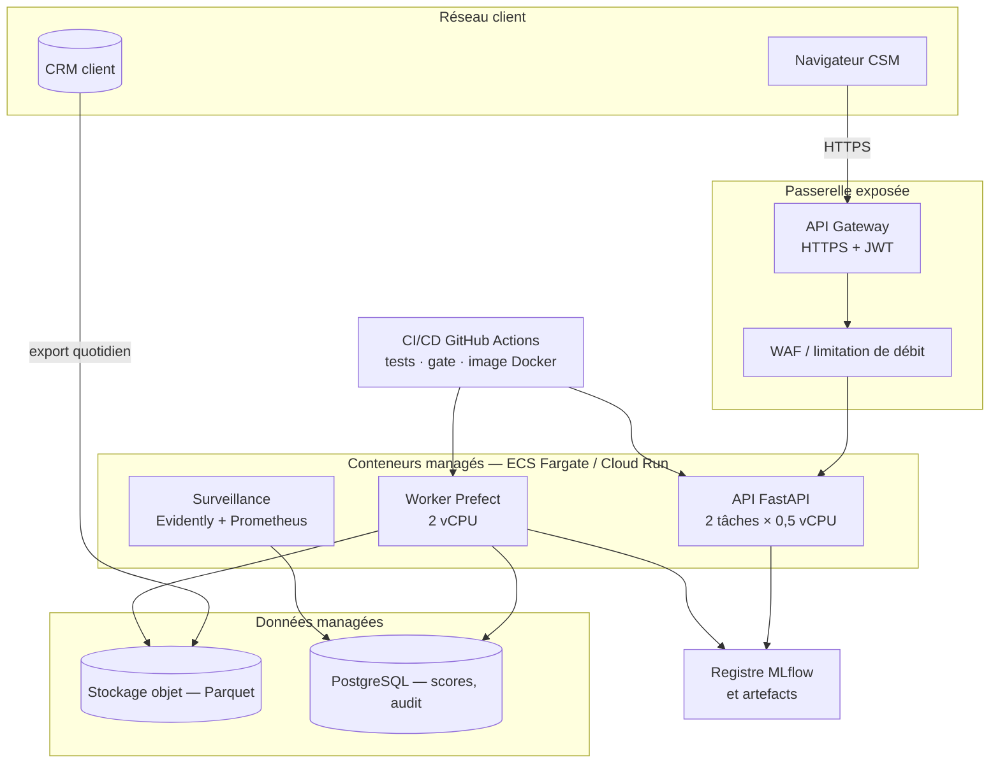
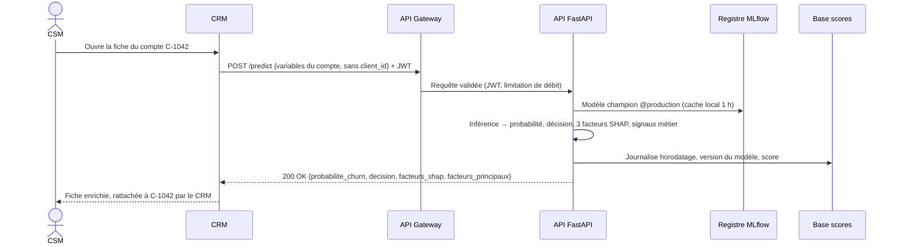

# Architecture cible — churn SaaS B2B

Document de référence technique. Les diagrammes reprennent ceux du notebook §11, dessinés par
`churn_saas.schemas` (`schema_pipeline_donnees`, `schema_architecture_cible`,
`schema_sequence_score`) ; en cas d'écart, le notebook fait foi. La section 4 distingue ce qui est
**livré** (V1, exécutable en local) de la **cible** de production.

---

## 1. Pipeline de données

Le batch de scoring part à 02 h 00 pour que les alertes soient dans le CRM avant 06 h 00. L'API
sert le **même** modèle champion : les vues batch et temps réel ne peuvent pas se contredire.

**Ce que le batch écrit pour chaque compte** (`flows/scoring_batch.py`, détail dans
`docs/RUNBOOK.md` §2.4) : la probabilité, le palier de la règle de décision à deux niveaux
(`ALERTE_ROUGE` ≥ 0,60, `SURVEILLANCE` au-dessus du seuil de vigilance, `OK`), le rang d'appel des
45 comptes de plus forte valeur attendue (niveau 2) et la valeur à risque. Le palier vient d'une
règle unique, `economie.niveau_risque`, partagée par l'API et le batch. Le seuil de vigilance
voyage avec le modèle : chaque promotion (flow de réentraînement ou `churn-saas train`, tous deux
soumis à la gate) le recalcule hors pli et l'écrit dans les métadonnées du modèle promu, archivées
avec lui pour le retour arrière (`churn-saas rollback`). Le modèle écrit par le notebook n'en
porte pas : le seuil de vigilance du §12 (`seuil_vigilance.json`) s'applique.

---

## 2. Architecture cible retenue — Scénario B (conteneurs managés)

Passerelle exposée, calcul conteneurisé sans serveur à administrer, données managées et registre
de modèles alimenté **uniquement** par la CI/CD. Aucune brique ne demande Kubernetes, et chacune a
un équivalent standard ailleurs (Docker, Parquet, PostgreSQL) : c'est la réversibilité exigée par
le RSSI. L'image Docker embarque `libgomp1`, requis par LightGBM, pour que le flow puisse servir
cette famille si une future exécution du notebook la désigne (champion actuel : régression
logistique).

---

## 3. Diagramme de séquence — Score à la demande (CSM → API → CRM)

Le `client_id` ne quitte jamais le CRM ; les features dérivées (ratios comme
`intensite_support`) sont calculées côté serveur, jamais demandées au client. La cible fait
évoluer par ajout l'API livrée (même route, même contrat d'entrée) :

| Élément | API livrée (§10) | Architecture cible |
|---|---|---|
| Authentification | Clé `X-API-Key`, 60 requêtes/min par IP | JWT validé par l'API Gateway |
| Raisons du score | 3 variables SHAP exactes (`facteurs_shap`) et 3 signaux métier de l'analyse exploratoire (`facteurs_principaux`) | Inchangé |
| Explication détaillée | Absente | `POST /explain` : toutes les variables, facteurs protecteurs compris |
| Journal d'audit | Absent (l'API ne persiste rien) | Chaque appel journalisé dans PostgreSQL, 12 mois |

**Budget de latence.** Le modèle seul répond en 61,9 ms au p95 (§9.13) ; l'appel complet
`POST /predict`, avec le recalcul des variables et des trois raisons SHAP, en 173 ms au p95
(rejeu du 10/10/2026, §10.3.3). Il reste environ 27 ms sous l'objectif de 200 ms pour le réseau,
la passerelle et la journalisation de la cible : la marge est faible, d'où l'alerte du SLO à
150 ms.

---

## 4. Livré (V1) et cible

| Brique | Livré, exécutable en local | Cible (scénario B) |
|---|---|---|
| Exécution de l'API | `docker-compose.yml` : `api`, `prometheus`, `grafana` ; un worker uvicorn | ECS Fargate ou Cloud Run, région Paris, 2 tâches |
| Modèle servi | Fichier `artifacts/models/best_model.pkl` et sa méta, montés en lecture seule ; le registre MLflow (alias `@production`) est tenu à jour mais l'API ne le lit pas | Modèle lu au registre MLflow partagé, cache local d'une heure |
| Données de référence de l'API | Catalogue des plans et `seuil_vigilance.json` montés fichier par fichier, en lecture seule (testé en conteneur le 11/10/2026) | Stockage objet |
| Scores | Parquet `reports/tables/scores_batch_<date>.parquet` | PostgreSQL managé, purge à 24 mois |
| Orchestration | Prefect : `nocturne` (02 h 00), `derive-hebdomadaire` (lundi 05 h 00), `sur-decision-comite` (sans planification) | Worker Prefect managé |
| Promotion et retour arrière | Gate `decision_promotion` (flow et `churn-saas train`) ; archive du modèle et de sa méta ; `churn-saas rollback <horodatage>` | Inchangé, sur le registre partagé |
| Surveillance | `/metrics` (Prometheus), alertes `APIIndisponible` et `LatenceElevee`, tableau de bord Grafana provisionné au démarrage (source Prometheus et tableau de bord, `monitoring/grafana/provisioning/`), rapport Evidently | Inchangé ; journal d'audit exporté vers le SIEM (exigence du RSSI) |
| CI/CD | `qualite` à chaque push ; `cd` sur étiquette `v*` : test de démarrage puis publication sur `ghcr.io` | Déploiement automatique sur l'infrastructure cible (non automatisé en V1) |

Procédures d'exploitation : `docs/RUNBOOK.md`.

---

## 5. Coût, trajectoire et niveaux de service

**Coût du scénario B** (pilote 5 000 comptes, tarifs publics 2025, non devisé) : environ 90 à
110 € par mois (calcul ≈ 31 €, PostgreSQL, stockage objet et MLflow ≈ 40 à 50 €, passerelle, WAF
et journaux ≈ 20 à 30 €), plus 15 à 20 € demandés par le RSSI. Scénario A : 30 à 60 €, sans haute
disponibilité ni retour arrière ; scénario C : 800 à 2 500 €, dépendance fournisseur (§11.6).
À 20 000 comptes avec redondance multi-zones : 300 à 450 € par mois.

**Trajectoire** : local (`Makefile`) → ECS Fargate à T+2 mois → test champion / challenger à
T+6 mois → scénario C réévalué à T+12 mois au-delà de 50 000 comptes (§11.7).

**SLO** (§11.8) : fraîcheur des scores ≤ 26 h ; latence p95 < 200 ms (alerte à 150 ms) ;
disponibilité 99,5 % de 06 h à 20 h ; PSI < 0,20 par variable ; PR-AUC ≥ 0,65 par cohorte de
renouvellements ; recall au seuil de vigilance ≥ 75 %. Un signal sur le modèle convoque un
comité, il ne réentraîne jamais seul.

---

## 6. Notes

- Secrets : en V1, la clé d'API passe par la variable d'environnement `CHURN_API_KEY` (vide =
  authentification désactivée, à réserver au développement). En cible, tous les secrets (clés,
  identifiants de base) passent par un gestionnaire de secrets (AWS Secrets Manager, GCP Secret
  Manager ou HashiCorp Vault), jamais en clair dans une image ou un fichier versionné.
- Souveraineté : le RSSI impose un fournisseur certifié ISO 27001 et la région Paris
  (`eu-west-3` ou `europe-west9`). Une région UE fixe le lieu, pas le droit applicable : un
  fournisseur américain reste soumis au Cloud Act, risque accepté pour des indicateurs
  d'entreprise (R10) ; un cloud qualifié SecNumCloud s'imposerait si des données personnelles
  entraient dans le périmètre.
- Le scénario recommandé (B) est argumenté en détail au §11 du notebook.
